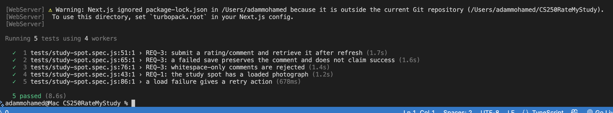
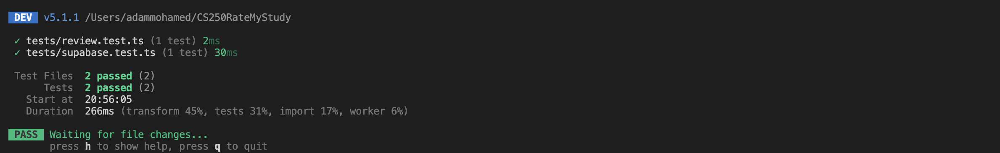

# Team Members
- Adam Mohamed
- Joshua Groh
- Hyejoo Lee
- Julio Miyazaqui

# Bug Triage Table
| Test Name | Bucket | Issue Link | Severity | Priority | Owner | Status |
|---|---|---|---|---|---|---|
| Supabase works with no environment variables passed | Code Bug | https://github.com/coregithub1/CS250RateMyStudy/issues/84 | Medium | Medium | Adam | Fixed |
| Invisible characters can be submitted | Code Bug | https://github.com/coregithub1/CS250RateMyStudy/issues/85 | Low | Medium | Adam | Fixed |
| Comment Limit of 2 | Code Bug | https://github.com/coregithub1/CS250RateMyStudy/issues/80 | Low | Low | Joshua | Fixed |
| | | | | | | | |
| | | | | | | | |
| | | | | | | | |
| | | | | | | | |
| | | | | | | | |

# Regression Log
Not a single old test broke from us adding new fixes or tweaking the current code!.
Ran the full suite on: Nov 19th, 20th, 22nd

# Final Test Run

Ran Nov 22, 8:49pm, 

All tests old and new all succeed.

# Feature Decision
### User story
As a user, I want the functionality of making reviews as a real user and applying my own username and account to a single review for online presence. 
### Why
This improves the entirety of the application as reviews can be updated, removed, and you can see peoples account history for other reviews they might've made.

### Who owns which part
Adam: Account logic
Joshua: Review updates, being able to remove reviews

### Tests
1. TC-1 | A user can register a account | The user will be able to register for an account,recieve a generated username
2. TC-2 | Every user will have their own profile page | The user will be able to visit a /u/[slug] page where they can see someone page and reviews

# Board Snapshot

# Sprint Summary
Across this sprint, the absolute hardest thing was picking out bugs. It was utterly difficult to find as much as we have here, but we can thorughly say that we tested and updated issues revolving hardcoded environment variables, invisibile characters via Unicode, and review submission limits. By the end of the sprint all old Playwright tests still worked as before, and the new vitest tests run end-to-end!