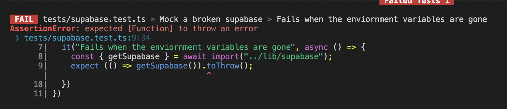
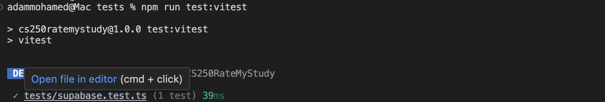
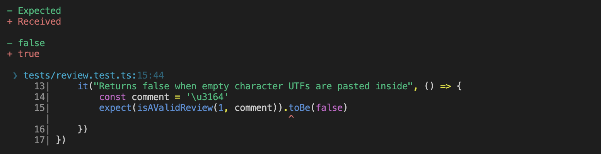

# Adam Mohamed

## Bug Fix #1 : Supabase works with no environment variables passed
Github Issue: https://github.com/coregithub1/CS250RateMyStudy/issues/85 \
Pull Request: https://github.com/coregithub1/CS250RateMyStudy/pull/86 \
Bug Classification: Code Bug 

#### Description
This is a trivial bug but hardcoding the environment variables is dangerous for longterm projects. Developers may unknowingly be connected to an incorrcet database, and removing these fallbacks ensure only one connection is allowed for each project (using .env.local)

### Before Fix

### After Fix

### Single Sentence
This was a code bug, identified by removing the fallback values they hardcoded and the database no longer connected. Vitest also couldn't get an error when the env stubbed values returned no error to getSupabase. 

## Bug Fix #2: Invisible characters can be submitted
Github Issue: https://github.com/coregithub1/CS250RateMyStudy/issues/85 \
Pull Request: https://github.com/coregithub1/CS250RateMyStudy/pull/86 \
Bug Classification: Code Bug 

#### Description
This was a very very hard edge case to find. But javascript will display \u[ints] in whatever it is describing during its conversion. If you submit the invisible character utf, it will techincally allow you copy paste 1000 characters of it and that will save inside the review table.

### Before Fix

### After Fix

### Single Sentence
This is a code bug because .trim() doesn't capture these utf characters, you have to do a regex check using /g to capture all instances of whatever invisible characters exist.